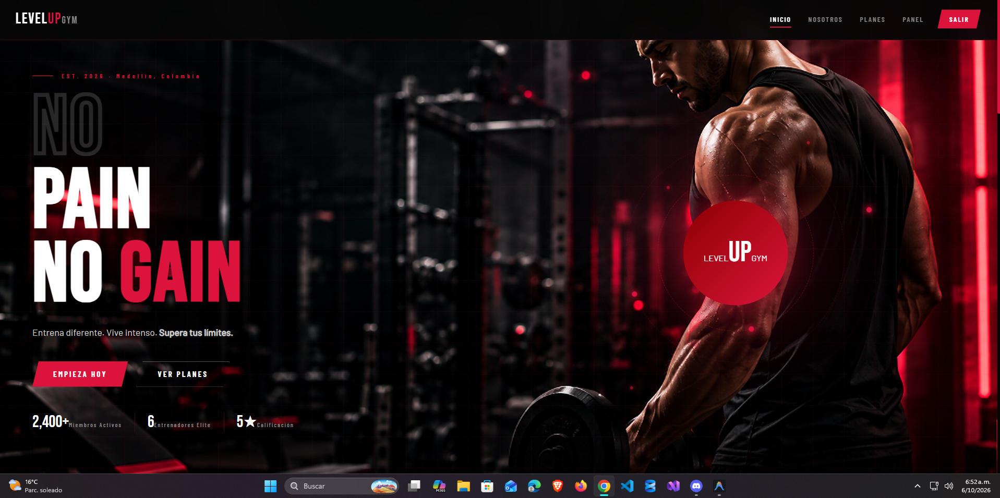
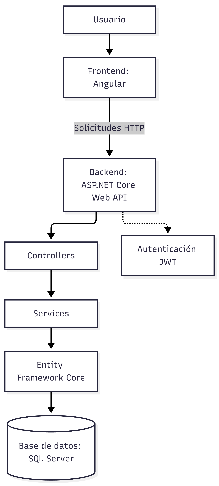
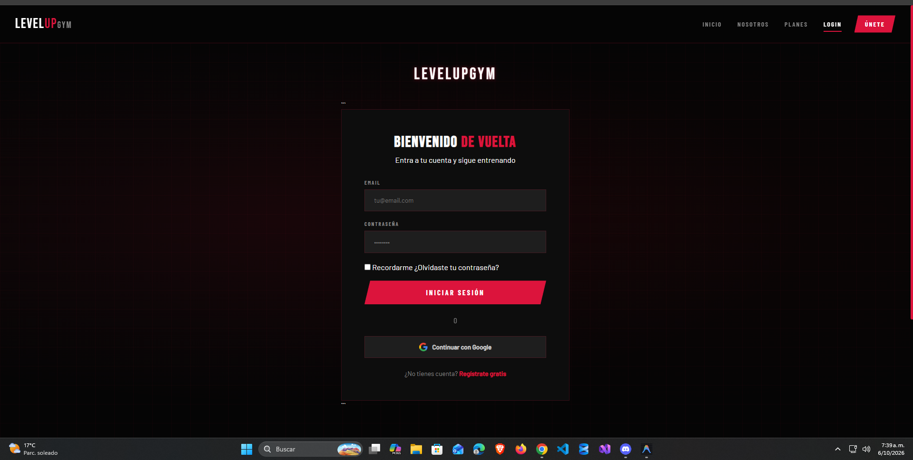
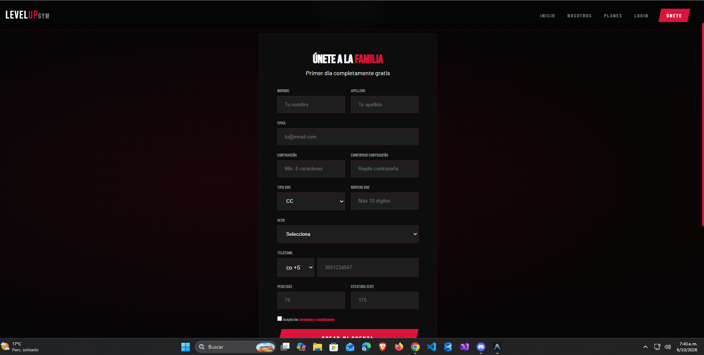
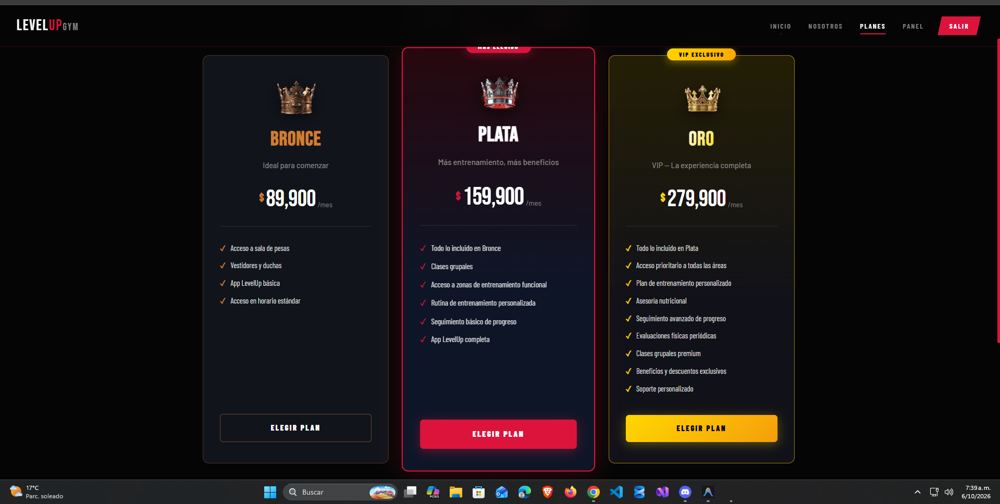
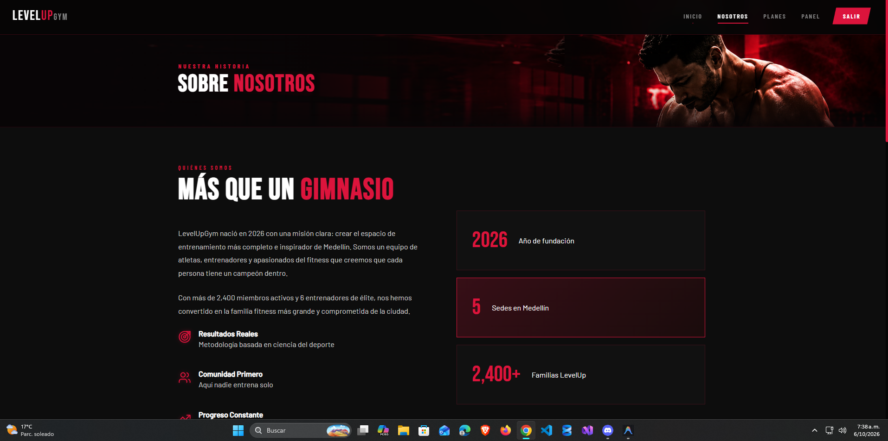
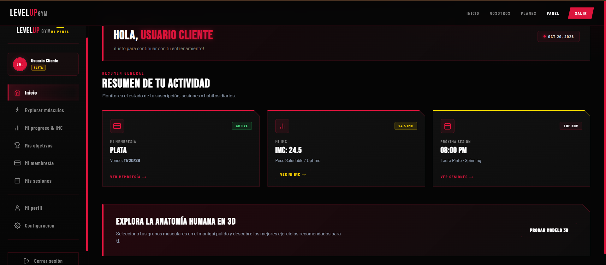
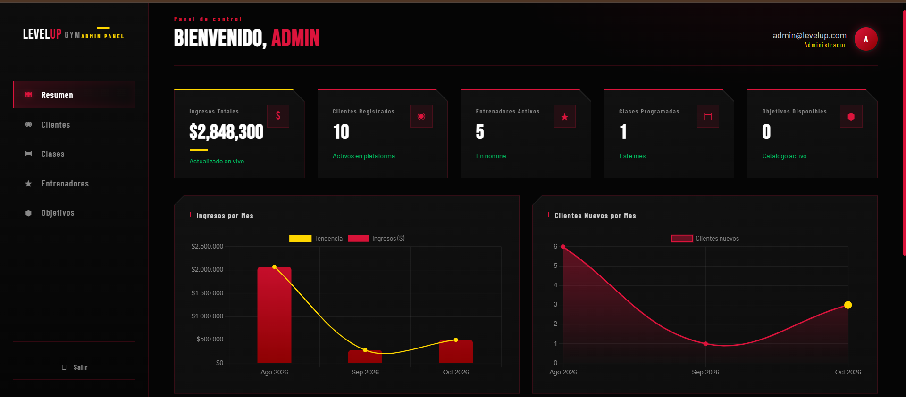
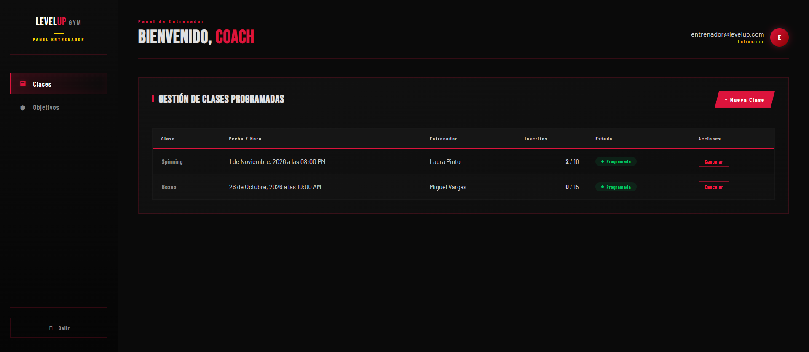

# LevelUpGym

> "Sistema web integral para la gestión de gimnasios, diseñado para administrar clientes, membresías, progreso físico, objetivos, clases grupales y procesos administrativos desde una plataforma centralizada."



## 📌 El problema
Los gimnasios necesitan administrar diferentes procesos relacionados con sus clientes, membresías, progreso físico, objetivos, clases y personal. Cuando esta información se gestiona de manera manual o mediante diferentes herramientas, puede ser difícil mantener un control organizado y actualizado.

## ✅ La solución
LevelUpGym es una plataforma web que centraliza la gestión de los principales procesos de un gimnasio, proporcionando herramientas específicas tanto para los administradores como para los clientes.

El sistema permite administrar la información de los usuarios, controlar membresías, realizar seguimiento del progreso físico, establecer objetivos, gestionar clases grupales y facilitar la interacción del cliente con los servicios del gimnasio.

**Funcionalidades principales:**
- Registro y gestión de clientes.
- Autenticación y control de acceso mediante roles.
- Gestión de planes de membresía.
- Procesamiento y registro de pagos.
- Creación y seguimiento de objetivos personales.
- Seguimiento del progreso corporal.
- Gestión de clases grupales y reservas.
- Gestión de entrenadores y roles del gimnasio.
- Programación de sesiones.
- Panel administrativo.
- Panel personalizado para clientes.
- Interfaz web responsive y moderna.

## 🛠️ Tecnologías
| Capa | Tecnología |
|---|---|
| Frontend | Angular |
| Backend | C# / ASP.NET Core .NET 10 |
| Base de datos | SQL Server |
| Otras | Git, GitHub, JWT, Entity Framework Core |

## 🏗️ Arquitectura
flowchart TD
    A["Usuario"] --> B["Frontend: Angular"]
    B -->|Solicitudes HTTP| C["Backend: ASP.NET Core Web API"]
    C --> D["Controllers"]
    D --> E["Services"]
    E --> F["Entity Framework Core"]
    F --> G[("Base de datos: SQL Server")]
    C -.-> H["Autenticación JWT"]

    

## 🚀 Cómo ejecutarlo
**Requisitos:** Antes de ejecutar el proyecto, asegúrate de tener instaladas las siguientes herramientas:

- Node.js, versión 20 o superior
- Angular CLI
- .NET 10 SDK
- SQL Server
- Git
- Visual Studio 2022 o Visual Studio Code (recomendado)

### Configurar la base de datos

Crea una base de datos en SQL Server y configura la cadena de conexión del proyecto backend.

En `appsettings.json` o `appsettings.Development.json`, configura (cambia `TU_SERVIDOR` por el nombre de tu servidor de SQL Server):

```json
{
  "ConnectionStrings": {
    "DefaultConnection": "Server=TU_SERVIDOR;Database=levelupgym_db;Integrated Security=True;TrustServerCertificate=True;MultipleActiveResultSets=False"
  }
}
```

### Clonar e instalar

```bash
# 1. Clonar el repositorio (rama dev)
git clone -b dev https://github.com/brayan25499/levelupgym-.git
cd levelupgym-

# 2. Backend
cd Backend/LevelUpGym.Api
dotnet restore
dotnet ef database update
dotnet run

# 3. Frontend (en otra terminal)
cd Frontend/LevelUpGym
npm install
npm start
```

**Demo:** [Video del proyecto funcionando](https://www.youtube.com/watch?v=eUAHRtpDb7c)

## 📸 Capturas

Estas son las pantallas principales de LevelUpGym. Las imágenes están en la carpeta `docs/` del repositorio.

| Pantalla | Descripción |
|---|---|
|  | Donde el usuario ingresa con su correo y contraseña. |
|  | Donde el usuario crea una cuenta nueva. |
|  | Donde el usuario revisa los planes disponibles. |
|  | Información del gimnasio y del equipo. |
|  | Dashboard del cliente con membresía, IMC, próxima sesión y descarga de factura. |
|  | Resumen con ingresos, clientes, entrenadores y gestión de clases. |
|  | Gestión de clases programadas del entrenador. |

## 👥 Equipo
| Nombre | Rol | GitHub |
|---|---|---|
| David Gonzalez | Backend, base de datos, frontend | [@bigbangblood](https://github.com/bigbangblood) |
| Brayan Valencia | Frontend,Backend| [@brayan25499](https://github.com/brayan25499) |
| Hillary Zabatt Cordoba | Frontend | [@hilly00](https://github.com/hilly00) |

**¿por qué escogieron cada tecnología?**

Angular (Frontend): lo elegimos porque permite construir interfaces dinámicas y organizar la aplicación mediante componentes reutilizables. Esto facilita el desarrollo de las diferentes pantallas del sistema, como el inicio de sesión, la gestión de membresías y los paneles de administración y clientes.

C# y ASP.NET Core (.NET 10) (Backend): escogimos estas tecnologías para desarrollar la lógica del sistema y gestionar la comunicación entre el frontend y la base de datos. ASP.NET Core permite crear APIs para procesar solicitudes HTTP, validar información y controlar las operaciones que realiza cada usuario.

SQL Server (Base de datos): lo seleccionamos porque permite almacenar la información del gimnasio de forma estructurada, relacionando datos como usuarios, membresías, pagos y clases. Además, facilita la integridad y consulta de la información mediante SQL.

Entity Framework Core (Acceso a datos): lo utilizamos para conectar el backend con SQL Server y trabajar con los datos mediante clases y objetos de C#. Esto reduce la necesidad de escribir consultas SQL manualmente para muchas operaciones y facilita el mantenimiento del código.

JWT (Autenticación): lo incorporamos para manejar la autenticación mediante tokens, permitiendo identificar las solicitudes de los usuarios y proteger los endpoints que requieren autorización. Esto ayuda a controlar el acceso a las funcionalidades según los permisos y roles definidos en la aplicación.

Git y GitHub (Control de versiones): los utilizamos para llevar un registro de los cambios realizados en el código y facilitar el trabajo colaborativo entre los integrantes del equipo. También permiten mantener el historial del proyecto y organizar el desarrollo de nuevas funcionalidades.

 **Pruebas realizadas** 

  Registro de usuarios: se verifica que el sistema permita registrar usuarios con datos válidos y que la información se almacene correctamente en la base de datos.

Inicio de sesión: se comprueba el acceso con credenciales válidas e inválidas para verificar que la autenticación funcione correctamente.

Control de acceso: se revisa que las funcionalidades protegidas respeten la autenticación y los roles asignados a cada usuario.

Gestión de membresías: se comprueba que los planes puedan consultarse y administrarse correctamente, de acuerdo con las funcionalidades implementadas.

Registro de pagos: se verifica el procesamiento y almacenamiento de la información de los pagos.

Persistencia de datos: se revisa que la información registrada desde la aplicación se guarde correctamente en SQL Server.

Comunicación entre frontend y backend: se comprueba que las solicitudes HTTP enviadas desde Angular sean procesadas por la API de ASP.NET Core y que las respuestas se reflejen correctamente en la interfaz.

Diseño responsive: se revisa la visualización de la aplicación en diferentes tamaños de pantalla para comprobar que la interfaz se adapte a computadores, tabletas y dispositivos móviles.

**Estructura de carpetas**

# Estructura del proyecto LevelUpGym

```text
LevelUpGym/
│
├── Backend/
│   └── LevelUpGym.Api/
│       ├── .vs/
│       ├── Artifacts/
│       ├── bin/
│       ├── Controllers/
│       ├── Data/
│       ├── DTOs/
│       ├── Migrations/
│       ├── Models/
│       ├── obj/
│       ├── Properties/
│       ├── Services/
│       ├── appsettings.json
│       ├── LevelUpGym.Api.csproj
│       ├── LevelUpGym.Api.http
│       ├── LevelUpGym.Api.... 
│       ├── Program.cs
│       └── WeatherForecast.cs
│
├── Frontend/
│   └── LevelUpGym/
│       ├── .angular/
│       ├── dist/
│       ├── node_modules/
│       ├── public/
│       ├── src/
│       │   ├── app/
│       │   ├── assets/
│       │   ├── environments/
│       │   ├── index.html
│       │   ├── main.ts
│       │   └── styles.css
│       ├── .editorconfig
│       ├── .gitignore
│       ├── .prettierrc
│       ├── angular.json
│       ├── netlify.toml
│       ├── package-lock.json
│       ├── package.json
│       ├── README.md
│       ├── tsconfig.app.json
│       ├── tsconfig.json
│       ├── tsconfig.spec.json
│       └── package-lock.json
│
├── docs/
├── CAMBIOS_IMPLEMENT...
├── package-lock.json
├── package.json
├── README.md
└── .gitignore
```


## 📄 Contexto
Proyecto formativo del programa **Análisis y Desarrollo de Software (ADSO)** · SENA · Centro de Tecnología Mobiliario · 2026.